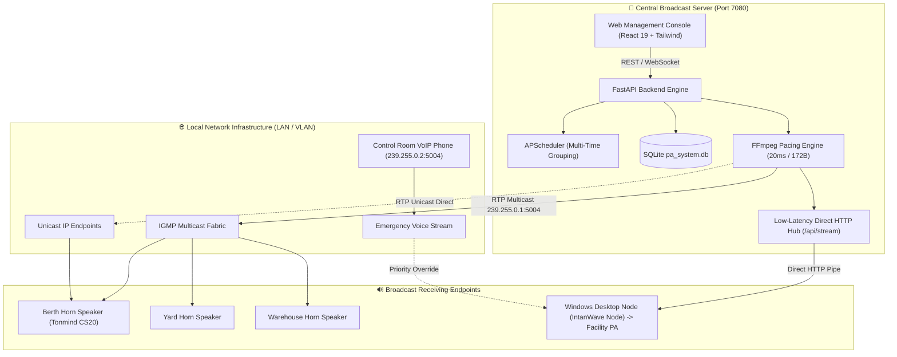

# 🔊 IntanWave — Industrial IP Audio & Maritime Public Address (PA) System

[](#-linux-server-deployment-docker)
[](https://fastapi.tiangolo.com)
[](https://vitejs.dev)
[](#-docker-resource-limits)
[](#-physical-ip-speaker-configuration)
[](LICENSE)

**IntanWave** is a centralized, industrial-grade IP Public Address (PA) and automated broadcast system designed for maritime ports, cargo terminals, industrial facilities, and corporate environments. It delivers zero-buffer, low-latency audio simultaneously to **physical IP Horn Speakers** (such as Tonmind CS20) via **RTP Multicast**, and to **Windows desktop client nodes** through a hybrid of **Direct Low-Latency HTTP streaming** and **UDP Multicast listener with VoIP IP Phone priority integration**.

---

## 🌟 Key Features

- 🚨 **Emergency Warning System (EWS)**:  
  One-click instant siren activation with explicit modal confirmation for disaster response, safety evacuations, and hazard alarms with zero stream-start latency.
- 🎯 **Flexible Zone & Selective Broadcast Targeting**:  
  Target **All Speakers**, specific **Zones** (e.g., *Berth / Jetty*, *Warehouse & Yard*, *Command Center*), or individual **Selective Horn Speakers** using *FFmpeg Shared-SSRC Tee Muxing* to eliminate audio echo.
- ⏱️ **Audio Pacing & Anti-Buffering Engine**:  
  Engineered to eliminate intermittent audio dropouts on long tracks (e.g., 4-minute anthems / 10MB+ audio) via strict **20ms frame slicing** (`aresample=8000:async=1,asetnsamples=n=160`) and locked **172-byte RTP datagrams** (`?pkt_size=172`).
- ⏰ **Multi-Time Group Broadcast Scheduler**:  
  Configure single rules with **multiple broadcast times** (e.g., `07:30`, `11:45`, `14:00`, `16:56`) using interactive time chips, shift presets (Morning Muster, Rest Break, Shift Closing), and real-time nearest alarm countdowns.
- 📡 **Real-Time Telemetry & Health Monitoring**:  
  Background parallel ICMP ping engine providing real-time online/offline indicators and sub-millisecond latency telemetry over persistent WebSockets.
- 💻 **Windows Desktop Receiver Client (`IntanWave Node`)**:  
  Standalone portable background tray app featuring **Dual-Channel Listening** (Central PA + Control Room VoIP IP Phone), dynamic codec auto-detection (**PCMU `pt=0`** vs. **PCMA `pt=8`**), and native Windows Toast Notifications.
- 🐳 **Lightweight Docker Architecture**:  
  Multi-stage container deployment utilizing `network_mode: "host"` on port **`7080`** with a strict **150MB memory ceiling** to safeguard host server stability.

---

## 🏗️ System Architecture



---

## 📁 Repository Structure

```text
IntanWave-RTPAudio/
├── backend/                       # Primary Backend (Python FastAPI + SQLite + APScheduler)
│   ├── app/
│   │   ├── audio_engine.py        # Audio streaming engine, 20ms pacing, shared SSRC, HTTP stream hub
│   │   ├── config.py              # Environment configurations & storage paths
│   │   ├── database.py            # SQLite schema migrations, clean seed data, audit logging
│   │   ├── main.py                # FastAPI REST & WebSocket endpoints, /api/health, /api/stream
│   │   ├── ping_service.py        # Asynchronous ICMP ping monitoring & latency telemetry
│   │   └── scheduler.py           # APScheduler engine with multi-time trigger support
│   ├── requirements.txt           # Python backend dependencies
│   └── storage/audio/             # Central repository for audio WAV/MP3 files
├── frontend/                      # Web Management Console (React 19 + Vite 8 + Tailwind)
│   ├── src/
│   │   ├── App.jsx                # UI components, modals, multi-time scheduler, telemetry
│   │   ├── index.css              # Custom industrial styling & animations
│   │   └── main.jsx               # React DOM entrypoint
│   ├── package.json               # Node.js dependencies
│   └── vite.config.js             # Vite build configuration
├── client-windows/                # Windows Receiver Client (IntanWave Node)
│   ├── IntanWave-Node/            # Portable, self-contained distribution folder
│   │   ├── IntanWave-Node.exe     # Standalone compiled client executable
│   │   ├── allow_firewall.bat     # Windows Defender UDP port 5004 authorization script
│   │   └── _internal/             # Python runtime & embedded FFmpeg audio engine
│   ├── app.py                     # System Tray GUI & single-instance enforcement
│   ├── receiver.py                # Dual-channel RTP/HTTP listener & VoIP codec auto-detection
│   ├── config.json                # Client configuration (emergency IP phone, volume, device name)
│   ├── IntanWave-Node.spec         # PyInstaller build specification (folder mode, UPX disabled)
│   └── start_client.bat           # Portable client launcher
├── Dockerfile                     # Multi-stage container build (Node builder + Python FFmpeg runner)
├── docker-compose.yml             # Docker compose specification with host networking & 150MB RAM limit
├── deploy-linux.sh                # Automated 1-step deployment script for Linux servers
├── run_server.py                  # Local development server launcher (Port 7080)
└── LICENSE                        # MIT License
```

---

## 🚀 Server Deployment Guide

### Option A: Linux Server Deployment (Docker Compose) — *Recommended*

The server operates on port **`7080`** by default. **Host networking mode** is utilized to ensure UDP Multicast datagrams egress directly onto physical network switches without container NAT interference.

```bash
# 1. Clone the repository
git clone https://github.com/pratama1246/IntanWave-RTPAudio.git
cd IntanWave-RTPAudio

# 2. Make deployment script executable
chmod +x deploy-linux.sh

# 3. Launch the automated deployment
./deploy-linux.sh
```

Or deploy directly using Docker Compose:
```bash
docker compose up -d --build
```

* **Web Console:** `http://<SERVER_IP>:7080`
* **Health Check API:** `http://<SERVER_IP>:7080/api/health`
* **Direct Audio Stream:** `http://<SERVER_IP>:7080/api/stream`
* **Live Server Logs:** `docker compose logs -f`

#### 🛡️ Docker Resource Limits
To prevent noisy-neighbor memory exhaustion in multi-container production environments, the container is bounded by:
```yaml
mem_limit: 150m
mem_reservation: 64m
deploy:
  resources:
    limits:
      memory: 150M
    reservations:
      memory: 64M
```

---

### Option B: Local Bare-Metal Setup (Python)

Ensure **Python 3.10+**, **Node.js 20+**, and **FFmpeg** are installed and accessible in your system `PATH`.

```powershell
# 1. Build frontend bundle
cd frontend
npm install
npm run build
cd ..

# 2. Install backend dependencies
pip install -r backend/requirements.txt

# 3. Launch server
python run_server.py
```
The console will be accessible at: `http://localhost:7080`

---

## 💻 Windows Client Setup (`IntanWave Node`)

The client application runs silently on staff workstations or guard post PCs connected to analog facility amplifiers.

### Installation & Launch:
1. Open the [`client-windows/IntanWave-Node`](client-windows/IntanWave-Node) folder.
2. *(First run only)* Right-click **`allow_firewall.bat`** ➔ **Run as administrator** to permit inbound UDP port 5004 traffic through Windows Defender Firewall.
3. Launch **`IntanWave-Node.exe`** (or execute `start_client.bat`).
4. The application docks quietly in the **System Tray** (near the Windows taskbar clock).

### Dual-Channel Receiver Capabilities:
* **Primary Audio Channel (Direct HTTP + Multicast Fallback)**: Automatically streams broadcast audio from the central server with zero packet dropouts across subnets and corporate firewalls.
* **Emergency IP Phone Channel (VoIP Priority)**: Concurrently listens for broadcast calls from the Control Room IP Phone (e.g., `239.255.0.2:5004`).
* **VoIP Codec Auto-Detection**: Automatically inspects RTP RFC 3550 headers to decode **PCMU (`pt=0`)** and **PCMA (`pt=8`)** streams on-the-fly without distortion.
* **Native Windows Toast**: Instant push notifications display broadcast details and emergency caller labels.

---

## 📻 Physical IP Speaker Configuration (e.g., Tonmind CS20)

To achieve flawless, uninterrupted playback on physical IP horn speakers:

1. Access your IP Speaker's web management interface.
2. Under **Audio Settings** / **RTP Multicast**, configure:
   * **Multicast IP**: `239.255.0.1`
   * **Port**: `5004`
   * **Audio Codec**: `PCMA (G.711 A-Law)`
   * **Sample Rate**: `8000 Hz`
   * **Priority**: `Priority 1` or `Priority 3` (per facility policy)
3. Under **Advanced / Hardware Settings**:
   * **Amp Auto OFF**: Set to **`NO`** *(prevents amplifier power-cycling on micro-silence)*.
   * **Jitter Buffer**: Set to **`360 ms`** or **`500 ms`** *(absorbs network jitter during multi-minute playback)*.
4. Save and apply settings.

---

## ⚙️ Environment Variables

| Variable | Default | Description |
|---|---|---|
| `PORT` | `7080` | HTTP Web Console & REST/WebSocket API port |
| `MULTICAST_IP` | `239.255.0.1` | Target RTP Multicast Group IP address |
| `MULTICAST_PORT` | `5004` | Inbound/Outbound UDP Audio Port |
| `TZ` | `Asia/Jakarta` | Local system timezone for APScheduler routines |
| `FRONTEND_DIST` | `../frontend/dist` | Path to compiled static frontend assets |

---

## 📄 License

This project is licensed under the [MIT License](LICENSE).
