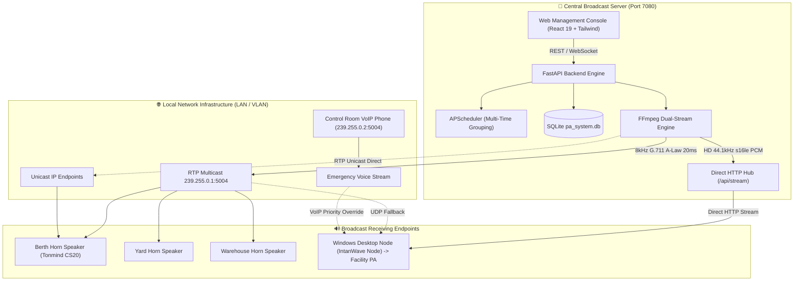

# 🔊 IntanWave — Industrial IP Audio & Maritime Public Address (PA) System

[](#-linux-server-deployment-docker-compose)
[](https://fastapi.tiangolo.com)
[](https://vitejs.dev)
[](#-dual-stream-hybrid-audio-engine)
[](#-docker-resource-limits)
[](#-physical-ip-speaker-configuration)
[](LICENSE)

**IntanWave** is a centralized, industrial-grade IP Public Address (PA) and automated broadcast system engineered for maritime ports, cargo terminals, industrial facilities, and corporate environments. It delivers synchronized, zero-buffer audio across distributed infrastructures using an innovative **Dual-Stream Hybrid Architecture**: high-fidelity **44.1 kHz PCM audio** for indoor desktop amplifier nodes over direct HTTP, and telecom-standard **8 kHz G.711 A-Law audio** over **RTP Multicast** for outdoor physical IP horn speakers (e.g., Tonmind CS20).

---

## 🌟 Key Features

### 🎵 Dual-Stream Hybrid Audio Engine
- **HD PCM Stream (44.1 kHz / 16-bit Mono)**: Streams uncompressed, CD-quality raw PCM audio via a low-latency HTTP pipe (`/api/stream`) to Windows desktop client nodes, delivering crystal-clear speech and rich music to facility amplifiers.
- **Telecom RTP Stream (8 kHz G.711 A-Law Mono)**: Concurrently encodes and broadcasts VoIP-standard audio over RTP Multicast (`239.255.0.1:5004`) and Unicast to physical IP horn speakers.
- **Unified Clock Synchronization**: Both streams originate from a single FFmpeg decode pipeline, ensuring zero delay disparity between indoor office nodes and outdoor berth horn speakers.

### ⏱️ Audio Pacing & Anti-Buffering Engine
- **20ms Frame Slicing**: Audio filters apply strict sample pacing (`aresample=8000:async=1,asetnsamples=n=160`) to eliminate drift and intermittent dropouts on long multi-minute broadcasts.
- **Locked 172-Byte Datagrams**: RTP payloads are strictly packetized at 160 bytes audio + 12 bytes header (`?pkt_size=172`) to perfectly align with IP speaker DSP jitter buffers.

### 🛡️ Anti-Echo & Stream Deduplication
- **Shared-SSRC Tee Muxing**: Transmits all simultaneous outputs using a coordinated SSRC (`ssrc={shared_ssrc}:seq=0`) to eliminate packet collision echoes.
- **Endpoint Deduplication**: If an IP speaker belongs to multiple overlapping groups or zones, the backend automatically deduplicates targets to prevent redundant stream delivery.
- **Thread-Safe Playback & Debouncing**: Atomic server-side locks and client UI debouncing prevent accidental double-clicks from disrupting ongoing broadcasts.

### 🆔 Smart Node Discovery & Persistent Identity
- **Dynamic Auto-Registration**: Windows desktop nodes automatically report hostname, local IP, and audio capabilities to the server on startup.
- **Stable Hardware Identity (`node_id`)**: Nodes retain a unique GUID in `config.json`. Rebuilding the client or renewing a DHCP IP address cleanly updates the existing database record rather than generating ghost duplicate entries.

### 🚨 Emergency Warning System (EWS) & Safety Modals
- **Instant Evacuation Siren**: Dedicated red alert trigger to broadcast emergency sirens across all terminals with zero buffer delay.
- **Broadcast Confirmation Modal**: An explicit confirmation dialog precedes manual playback from the Audio Library table, preventing accidental live broadcasts.

### ⏰ Multi-Time Group Broadcast Scheduler
- **Multiple Broadcast Times per Rule**: Configure single rules with several trigger points (e.g., `07:30`, `11:45`, `14:00`, `16:56`) rendered as high-contrast time badges.
- **Shift Presets & Ellipsis Truncation**: Quick-fill buttons for common port routines (Morning Muster, Rest Breaks, Shift Closing) with smart `...` truncation for dense lists.
- **Dynamic Nearest Countdown**: Live countdown card continuously tracks and displays the time remaining until the next upcoming broadcast.

### 📡 Real-Time Telemetry & Health Monitoring
- **Parallel Asynchronous ICMP Ping**: Continuous background heartbeat monitoring tracking latency and online/offline states across all registered IP endpoints.
- **WebSocket Live State Push**: Telemetry and playback state changes update instantaneously across connected browser consoles without page reloads.

### 💻 Windows Desktop Receiver Client (`IntanWave Node`)
- **Dual-Channel Multi-Socket Listener**: Concurrently receives broadcasts from the central server and emergency calls from the Control Room VoIP IP Phone (e.g., `239.255.0.2:5004`).
- **VoIP Codec Auto-Detection**: Inspects incoming RTP RFC 3550 headers to seamlessly decode both **PCMU (`pt=0`)** and **PCMA (`pt=8`)** without audio distortion.
- **Background Tray & Toast Notifications**: Sits unobtrusively in the Windows System Tray with native Windows Toast alerts indicating stream title and caller identity.

---

## 🏗️ System Architecture



---

## 📁 Repository Structure

```text
IntanWave-RTPAudio/
├── backend/                       # Primary Backend (Python FastAPI + SQLite + APScheduler)
│   ├── app/
│   │   ├── audio_engine.py        # Dual-stream engine (44.1kHz HD PCM & 8kHz RTP), pacing, shared SSRC
│   │   ├── stream_hub.py          # Asynchronous pub/sub buffer hub for direct HTTP audio streaming
│   │   ├── config.py              # Environment configurations, port mappings, storage paths
│   │   ├── database.py            # SQLite schema migrations, smart node upsert, audit logging
│   │   ├── main.py                # REST & WebSocket API, /api/health, /api/stream, auto-discovery
│   │   ├── ping_service.py        # Parallel ICMP ping engine & latency telemetry
│   │   └── scheduler.py           # APScheduler engine with multi-time trigger support
│   ├── requirements.txt           # Python backend dependencies
│   └── storage/audio/             # Central repository for audio WAV/MP3 files
├── frontend/                      # Web Management Console (React 19 + Vite 8 + Tailwind)
│   ├── src/
│   │   ├── App.jsx                # UI components, confirmation modals, multi-time scheduler
│   │   ├── index.css              # Industrial styling, truncation utilities, status indicators
│   │   └── main.jsx               # React DOM entrypoint
│   ├── package.json               # Node.js dependencies
│   └── vite.config.js             # Vite build configuration
├── client-windows/                # Windows Receiver Client (IntanWave Node)
│   ├── IntanWave-Node/            # Portable, self-contained distribution folder
│   │   ├── IntanWave-Node.exe     # Standalone compiled client executable
│   │   ├── allow_firewall.bat     # Windows Defender UDP port 5004 authorization script
│   │   └── _internal/             # Python runtime & embedded FFmpeg audio engine
│   ├── app.py                     # System Tray GUI, settings modal, single-instance enforcement
│   ├── receiver.py                # Dual-channel RTP/HTTP listener & VoIP codec auto-detection
│   ├── config.json                # Client configuration (persistent node_id, IP phone, volume)
│   ├── IntanWave-Node.spec         # PyInstaller build specification (folder mode, UPX disabled)
│   └── start_client.bat           # Portable client launcher
├── Dockerfile                     # Multi-stage container build (Node builder + Python FFmpeg runner)
├── docker-compose.yml             # Docker compose specification with host networking & 150MB RAM limit
├── deploy-linux.sh                # Automated 1-step deployment script for Linux servers
├── run_server.py                  # Local development server launcher (Port 7080)
└── LICENSE                        # MIT License
```

---

## 🚀 Server Deployment Guide

### Option A: Linux Server Deployment (Docker Compose) — *Recommended*

The server operates on port **`7080`** by default. **Host networking mode** is utilized to ensure UDP Multicast datagrams egress directly onto physical network switches without container NAT interference.

```bash
# 1. Clone the repository
git clone https://github.com/pratama1246/IntanWave-RTPAudio.git
cd IntanWave-RTPAudio

# 2. Make deployment script executable
chmod +x deploy-linux.sh

# 3. Launch the automated deployment
./deploy-linux.sh
```

Or deploy directly using Docker Compose:
```bash
docker compose up -d --build
```

* **Web Console:** `http://<SERVER_IP>:7080`
* **Health Check API:** `http://<SERVER_IP>:7080/api/health`
* **Direct Audio Stream:** `http://<SERVER_IP>:7080/api/stream`
* **Live Server Logs:** `docker compose logs -f`

#### 🛡️ Docker Resource Limits
To prevent noisy-neighbor memory exhaustion in multi-container production environments, the container is bounded by:
```yaml
mem_limit: 150m
mem_reservation: 64m
deploy:
  resources:
    limits:
      memory: 150M
    reservations:
      memory: 64M
```

---

### Option B: Local Bare-Metal Setup (Python)

Ensure **Python 3.10+**, **Node.js 20+**, and **FFmpeg** are installed and accessible in your system `PATH`.

```powershell
# 1. Build frontend bundle
cd frontend
npm install
npm run build
cd ..

# 2. Install backend dependencies
pip install -r backend/requirements.txt

# 3. Launch server
python run_server.py
```
The console will be accessible at: `http://localhost:7080`

---

## 💻 Windows Client Setup (`IntanWave Node`)

The client application runs silently on staff workstations or guard post PCs connected to analog facility amplifiers.

### Installation & Launch:
1. Open the [`client-windows/IntanWave-Node`](client-windows/IntanWave-Node) folder.
2. *(First run only)* Right-click **`allow_firewall.bat`** ➔ **Run as administrator** to permit inbound UDP port 5004 traffic through Windows Defender Firewall.
3. Launch **`IntanWave-Node.exe`** (or execute `start_client.bat`).
4. The application docks quietly in the **System Tray** (near the Windows taskbar clock).

### Dual-Channel Receiver Capabilities:
* **Primary Audio Channel (Direct HTTP + Multicast Fallback)**: Streams **CD-Quality 44.1 kHz raw PCM** audio from the central server with zero packet dropouts across subnets and corporate firewalls.
* **Emergency IP Phone Channel (VoIP Priority)**: Concurrently listens for broadcast calls from the Control Room IP Phone (e.g., `239.255.0.2:5004`).
* **VoIP Codec Auto-Detection**: Automatically inspects RTP RFC 3550 headers to decode **PCMU (`pt=0`)** and **PCMA (`pt=8`)** streams on-the-fly without distortion.
* **Smart Auto-Registration**: Automatically registers with the server under a persistent hardware `node_id`, preventing duplicate ghost nodes when reconnecting or renewing DHCP IPs.
* **Native Windows Toast**: Instant push notifications display broadcast details and emergency caller labels.

---

## 📻 Physical IP Speaker Configuration (e.g., Tonmind CS20)

To achieve flawless, uninterrupted playback on physical IP horn speakers:

1. Access your IP Speaker's web management interface.
2. Under **Audio Settings** / **RTP Multicast**, configure:
   * **Multicast IP**: `239.255.0.1`
   * **Port**: `5004`
   * **Audio Codec**: `PCMA (G.711 A-Law)`
   * **Sample Rate**: `8000 Hz`
   * **Priority**: `Priority 1` or `Priority 3` (per facility policy)
3. Under **Advanced / Hardware Settings**:
   * **Amp Auto OFF**: Set to **`NO`** *(prevents amplifier power-cycling on micro-silence)*.
   * **Jitter Buffer**: Set to **`360 ms`** or **`500 ms`** *(absorbs network jitter during multi-minute playback)*.
4. Save and apply settings.

---

## ⚙️ Environment Variables

| Variable | Default | Description |
|---|---|---|
| `PORT` | `7080` | HTTP Web Console & REST/WebSocket API port |
| `MULTICAST_IP` | `239.255.0.1` | Target RTP Multicast Group IP address |
| `MULTICAST_PORT` | `5004` | Inbound/Outbound UDP Audio Port |
| `TZ` | `Asia/Jakarta` | Local system timezone for APScheduler routines |
| `FRONTEND_DIST` | `../frontend/dist` | Path to compiled static frontend assets |

---

## 📄 License

This project is licensed under the [MIT License](LICENSE).
