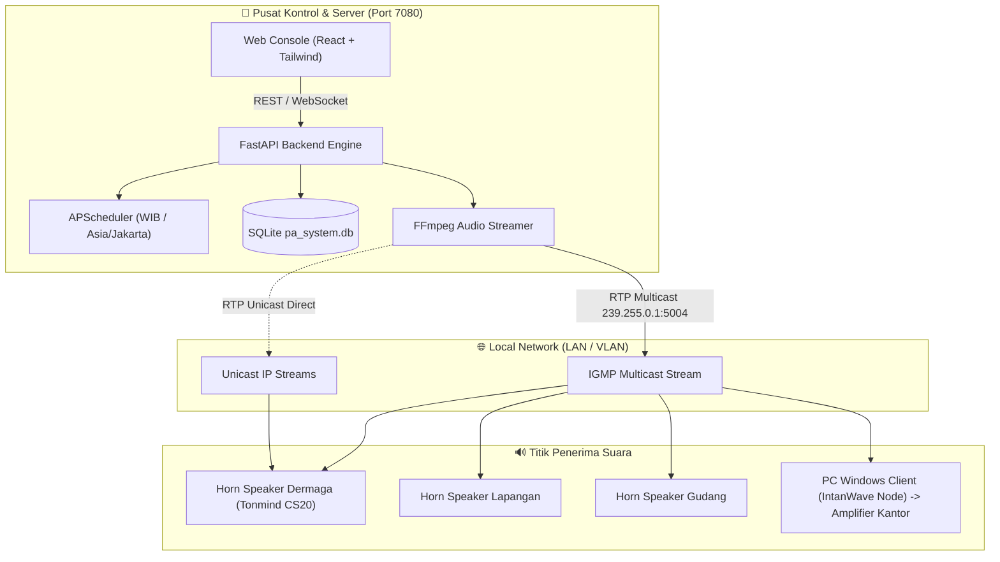

# 🔊 IntanWave — Industrial IP Audio & Maritime PA System

[](#-deployment-di-linux-docker)
[](https://fastapi.tiangolo.com)
[](https://vitejs.dev)
[](#-konfigurasi-perangkat-speaker-ip)
[](LICENSE)

**IntanWave** adalah sistem *Public Address* (PA) dan siaran audio terpusat berbasis **IP Network** yang dirancang untuk kebutuhan operasional pelabuhan, kawasan industri, pergudangan, dan perkantoran. Sistem ini mampu memancarkan streaming audio *real-time* ke **IP Horn Speaker fisik** (seperti Tonmind CS20) melalui **RTP Multicast**, sekaligus ke **PC Desktop Windows Klien** (Amplifier Pos / Kantor) secara simultan.

---

## 🌟 Fitur Utama

- 🚨 **Emergency Warning System (EWS) / Sirine Darurat**:  
  Tombol cepat siaga darurat merah dengan konfirmasi modal untuk menyiarkan sirine evakuasi seketika ke seluruh area tanpa jeda buffer.
- 🎯 **Siaran Selektif & Zonasi Fleksibel**:  
  Siarkan audio ke **Semua Area**, per **Zona Khusus** (misal: *Dermaga*, *Lapangan & Gudang*, *Kantor & Kontrol*), atau langsung ke **Speaker Tertentu** menggunakan *FFmpeg Tee Muxer*.
- ⏰ **Penjadwalan Otomatis (Scheduler)**:  
  Otomasi siaran berkala (Apel Pagi, Pengingat K3, Jam Istirahat, Penutupan Kerja) dengan opsi hari kustom (Senin–Minggu), interval, atau sekali putar (*once*).
- 📡 **Telemetri & Status Speaker Real-Time**:  
  Monitoring ICMP Ping paralel otomatis dengan indikator online/offline dan latensi sub-milidetik via WebSocket interaktif.
- 📁 **Pustaka Berkas Audio**:  
  Unggah audio drag-and-drop dengan pengelompokan kategori (*Suara Biasa* vs *Suara Darurat EWS*) dan pemutar pratinjau audio bawaan browser.
- 🐳 **Server Linux Berbasis Docker**:  
  Mendukung *host networking* di Linux untuk transmisi paket UDP Multicast langsung ke switch fisik jaringan lokal.
- 💻 **Desktop Client Windows (IntanWave Node)**:  
  Aplikasi penerima portabel mandiri (*tray icon*, notifikasi *Windows Toast native*, zero-install).

---

## 🏗️ Arsitektur Sistem



---

## 📁 Struktur Direktori

```text
IntanWave-RTPAudio/
├── backend/                  # Server Utama (Python FastAPI + SQLite + APScheduler)
│   ├── app/                  # REST API, audio engine, ping telemetry, websocket
│   ├── requirements.txt      # Dependensi Python backend
│   └── storage/audio/        # Direktori penyimpanan file audio WAV/MP3
├── frontend/                 # Web Dashboard Console (React 19 + Vite 8 + Tailwind)
│   ├── src/                  # Komponen UI, modal konfirmasi, live telemetry
│   └── package.json          # Node.js dependencies
├── client-windows/           # Pure RTP Receiver Client untuk PC Windows
│   ├── app.py                # System Tray GUI & Single Instance Handler
│   ├── receiver.py           # RTP Multicast Listener & Audio Output
│   ├── allow_firewall.bat    # Script helper izin port firewall UDP 5004
│   └── start_client.bat      # Launcher portable client
├── Dockerfile                # Multi-stage Docker build (Node builder + Python FFmpeg runner)
├── docker-compose.yml        # Orchestration compose dengan host networking
├── deploy-linux.sh           # Script 1-klik deploy otomatis untuk Linux server
└── run_server.py             # Entrypoint lokal untuk menjalankan server
```

---

## 🚀 Panduan Menjalankan Server

### Opsi A: Deployment di Linux (Docker / Docker Compose) — *Disarankan*

Server menggunakan port **`7080`** dan mode *host networking* agar paket RTP Multicast langsung memancar ke interface LAN fisik:

```bash
# 1. Clone repository
git clone https://github.com/pratama1246/IntanWave-RTPAudio.git
cd IntanWave-RTPAudio

# 2. Beri izin eksekusi script deploy
chmod +x deploy-linux.sh

# 3. Jalankan deployment otomatis
./deploy-linux.sh
```

Atau menggunakan Docker Compose langsung:
```bash
docker compose up -d --build
```

* **Akses Dashboard Web:** `http://<IP-SERVER>:7080`
* **API Health Check:** `http://<IP-SERVER>:7080/api/health`
* **Melihat Log Server:** `docker compose logs -f`

---

### Opsi B: Menjalankan Langsung di Python (Development)

Pastikan sistem sudah memiliki **Python 3.10+**, **Node.js 20+**, dan **FFmpeg** terpasang di sistem PATH.

```powershell
# 1. Build frontend terlebih dahulu
cd frontend
npm install
npm run build
cd ..

# 2. Pasang dependensi backend
pip install -r backend/requirements.txt

# 3. Jalankan server
python run_server.py
```
Server akan aktif di: `http://localhost:7080`

---

## 💻 Panduan Windows Client (`IntanWave Node`)

Aplikasi client ini dipasang di PC staf / ruang kantor yang kabel soundcard-nya terhubung ke amplifier analog:

1. Buka folder `client-windows/`.
2. *(Pertama kali)* Klik kanan file **`allow_firewall.bat`** ➔ **Run as administrator** untuk membuka akses port UDP 5004 di Windows Defender.
3. Jalankan **`start_client.bat`** atau file executable `IntanWave-Node.exe`.
4. Aplikasi akan aktif di **System Tray** (dekat jam Windows di pojok kanan bawah).
5. Saat siaran berbunyi dari server, notifikasi **Windows Toast** akan muncul seketika dan audio mengudara melalui speaker amplifier.

---

## 📻 Konfigurasi Perangkat IP Speaker (Contoh: Tonmind CS20)

Pada halaman admin web masing-masing IP Horn Speaker fisik:
1. Buka menu **Audio Settings** / **RTP Multicast**.
2. Masukkan parameter berikut:
   * **Multicast IP**: `239.255.0.1`
   * **Port**: `5004`
   * **Codec**: `PCMA (G.711 A-Law)`
   * **Sample Rate**: `8000 Hz`
   * **Priority**: `Priority 1` atau `Priority 3` (sesuai konfigurasi hirarki Anda)
3. Simpan pengaturan. Speaker akan otomatis memutar siaran ketika server mengudara.

---

## ⚙️ Variabel Lingkungan (*Environment Variables*)

| Variabel | Default | Keterangan |
|---|---|---|
| `PORT` | `7080` | Port HTTP Web Dashboard & REST API |
| `MULTICAST_IP` | `239.255.0.1` | Alamat IP Grup Multicast RTP |
| `MULTICAST_PORT` | `5004` | Port UDP Multicast Audio |
| `TZ` | `Asia/Jakarta` | Zona waktu untuk penjadwalan siaran |

---

## 📄 Lisensi

Proyek ini dirilis di bawah lisensi [MIT License](LICENSE).
