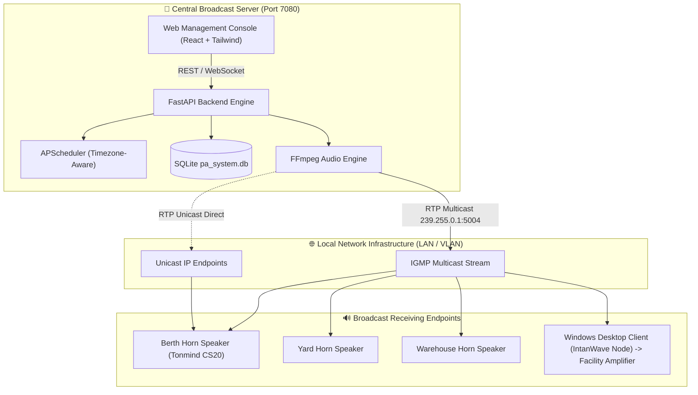

# 🔊 IntanWave — Industrial IP Audio & Maritime Public Address (PA) System

[](#-linux-deployment-docker-compose)
[](https://fastapi.tiangolo.com)
[](https://vitejs.dev)
[](#-physical-ip-speaker-configuration)
[](LICENSE)

**IntanWave** is a centralized, industrial-grade IP Public Address (PA) and automated audio broadcast system tailored for maritime ports, cargo terminals, industrial facilities, and corporate environments. It delivers zero-buffer, low-latency audio simultaneously to **physical IP Horn Speakers** (such as Tonmind CS20) via **RTP Multicast**, as well as to **remote Windows desktop client nodes** connected to facility amplifiers.

---

## 🌟 Key Features

- 🚨 **Emergency Warning System (EWS)**:  
  One-click instant siren activation with modal confirmation for safety evacuations, hazard alarms, and emergency broadcasts without stream buffering delays.
- 🎯 **Flexible Zone & Selective Broadcast Targeting**:  
  Target **All Speakers**, specific **Zones** (e.g., *Berth / Jetty*, *Warehouse & Yard*, *Command Center*), or individual **Selective Horn Speakers** simultaneously using *FFmpeg Tee Muxing*.
- ⏰ **Automated Broadcast Scheduler**:  
  Automate recurring routines (Morning Muster, HSE Safety Reminders, Shift Change Chimes) with customizable day-of-week schedules (Monday–Sunday), interval loops, or one-shot executions.
- 📡 **Real-Time Telemetry & Speaker Health Monitoring**:  
  Background parallel ICMP ping engine providing real-time online/offline indicators and sub-millisecond latency telemetry via persistent WebSockets.
- 📁 **Categorized Audio Library**:  
  Web dropzone uploader with automated tagging and dual categorization (*Standard Chimes* vs. *Emergency EWS Sirens*), complete with in-browser audio preview.
- 🐳 **Production-Ready Docker for Linux**:  
  Containerized deployment utilizing `network_mode: "host"` to ensure UDP Multicast streams egress directly onto physical LAN switch interfaces.
- 💻 **Windows Desktop Receiver Client (`IntanWave Node`)**:  
  Standalone portable background tray app featuring native Windows Toast Notifications, single-instance process lock, and zero-configuration discovery.

---

## 🏗️ System Architecture



---

## 📁 Repository Structure

```text
IntanWave-RTPAudio/
├── backend/                  # Primary Backend (Python FastAPI + SQLite + APScheduler)
│   ├── app/                  # REST API, audio engine, ping telemetry, websocket
│   ├── requirements.txt      # Python backend dependencies
│   └── storage/audio/        # Central repository for audio WAV/MP3 files
├── frontend/                 # Web Management Console (React 19 + Vite 8 + Tailwind)
│   ├── src/                  # UI components, modals, telemetry monitors
│   └── package.json          # Node.js dependencies
├── client-windows/           # Pure RTP Receiver Client for Windows PCs
│   ├── app.py                # System Tray GUI & single-instance enforcement
│   ├── receiver.py           # RTP Multicast Listener & audio player engine
│   ├── allow_firewall.bat    # Helper script for Windows Defender UDP 5004 rule
│   └── start_client.bat      # Portable client launcher
├── Dockerfile                # Multi-stage container build (Node builder + Python FFmpeg runner)
├── docker-compose.yml        # Docker compose specification with host networking
├── deploy-linux.sh           # Automated 1-step deployment script for Linux servers
└── run_server.py             # Development server launcher
```

---

## 🚀 Server Deployment Guide

### Option A: Linux Deployment (Docker Compose) — *Recommended*

The server operates on port **`7080`** by default. Host networking mode is used to guarantee that UDP Multicast packets flow directly to physical switch fabrics and horn speakers without container bridge NAT interference:

```bash
# 1. Clone the repository
git clone https://github.com/pratama1246/IntanWave-RTPAudio.git
cd IntanWave-RTPAudio

# 2. Make deployment script executable
chmod +x deploy-linux.sh

# 3. Launch the automated deployment
./deploy-linux.sh
```

Or deploy directly with Docker Compose:
```bash
docker compose up -d --build
```

* **Web Console:** `http://<SERVER_IP>:7080`
* **Health Check API:** `http://<SERVER_IP>:7080/api/health`
* **Inspect Logs:** `docker compose logs -f`

---

### Option B: Local Development (Bare Metal Python)

Ensure **Python 3.10+**, **Node.js 20+**, and **FFmpeg** are installed and accessible in your system `PATH`.

```powershell
# 1. Build frontend bundle
cd frontend
npm install
npm run build
cd ..

# 2. Install backend dependencies
pip install -r backend/requirements.txt

# 3. Launch server
python run_server.py
```
The server will be reachable at: `http://localhost:7080`

---

## 💻 Windows Client Setup (`IntanWave Node`)

The desktop receiver client is designed for staff workstations or guard posts where audio output jacks connect to analog PA amplifiers:

1. Open the `client-windows/` directory.
2. *(First run)* Right-click **`allow_firewall.bat`** ➔ **Run as administrator** to permit inbound UDP 5004 traffic through Windows Defender Firewall.
3. Run **`start_client.bat`** or launch `IntanWave-Node.exe`.
4. The client docks silently in the **System Tray** (near the Windows taskbar clock).
5. Whenever a broadcast is initiated from the central server, a native **Windows Toast Notification** appears and audio streams immediately through the connected speakers.

---

## 📻 Physical IP Speaker Configuration (e.g., Tonmind CS20)

In your physical IP Horn Speaker's web administration panel:
1. Navigate to **Audio Settings** / **RTP Multicast**.
2. Configure the following stream parameters:
   * **Multicast IP**: `239.255.0.1`
   * **Port**: `5004`
   * **Audio Codec**: `PCMA (G.711 A-Law)`
   * **Sample Rate**: `8000 Hz`
   * **Channel**: `Mono`
   * **Priority**: `Priority 1` or `Priority 3` (based on your override hierarchy)
3. Save and apply settings. The speaker will immediately play incoming broadcasts from the server.

---

## ⚙️ Environment Variables

| Variable | Default | Description |
|---|---|---|
| `PORT` | `7080` | HTTP Web Console & REST/WebSocket API port |
| `MULTICAST_IP` | `239.255.0.1` | Target RTP Multicast Group IP address |
| `MULTICAST_PORT` | `5004` | Inbound/Outbound UDP Audio Port |
| `TZ` | `Asia/Jakarta` | Local system timezone for the broadcast scheduler |

---

## 📄 License

This project is licensed under the [MIT License](LICENSE).
