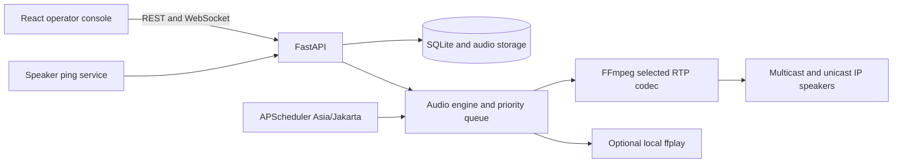

# IntanWave RTP Audio

<p align="center"></p>

LAN-based public-address audio server with a React management console, FastAPI backend, SQLite storage, scheduled announcements, and FFmpeg RTP multicast/unicast delivery to IP speakers. Developed for the Pelindo Multi Terminal Tanjung Intan context; source availability does not establish site acceptance or emergency-system certification.

This repository is the **web/Python RTP server**, not IntanWave Desktop (C#/WinUI). **Start:** [Prepare a Linux Docker instance](#prepare-a-linux-docker-instance) or [Run a development instance](#run-a-development-instance). **Project contact:** [Pratama Putra](https://github.com/pratama1246); use [repository issues](https://github.com/pratama1246/IntanWave-RTPAudio/issues) for reproducible software faults. The site owner must define operational contacts; no on-call rota or response-time commitment is documented here.

## Reader assumptions

Operators should understand LAN/VLAN addressing, UDP/multicast reachability, receiver configuration, and server logs. Developers additionally need Python, pnpm, and React/FastAPI. Commands run from the repository root unless another directory is stated. Docker commands below target Linux host networking; Windows development uses a separate Python process.

RTP transports encoded audio, not an assurance of acoustic synchronization. ICMP ping tests reachability, not audio reception. A successful HTTP health check does not prove that a horn speaker is playing. Site audio and emergency operating procedures take precedence over a dashboard indicator.

## Choose a section

- [Developer and installation procedures](#developer-and-installation-procedures)
- [Operator procedures](#operator-procedures)
- [Troubleshooting and escalation](#troubleshooting-and-escalation)
- [Configuration reference](#configuration-reference)
- [Dependency reference](#dependency-reference)
- [Architecture explanation](#architecture-explanation)
- [Source reference](#source-reference)
- [License](#license)

## Developer and installation procedures

### Prepare a Linux Docker instance

Use an isolated test host/network first. Startup initializes the application and scheduler; an existing storage directory may contain enabled schedules. The Compose file uses host networking, a 150m memory cap, and local storage/code mounts. The cap is a configured limit, not a measured memory requirement or availability guarantee.

1. On the Linux host, clone the repository with `git clone https://github.com/pratama1246/IntanWave-RTPAudio.git`.
2. Enter the checkout directory with `cd IntanWave-RTPAudio`.
3. Inspect `docker-compose.yml`, especially destinations, storage/code mounts, host networking, and existing schedules in the intended database. Coordinate isolation of operational receivers before startup.
4. At the repository root, run `docker compose up -d --build`.
5. At the same location, run `docker compose ps` and check the `audio-server` service state.
6. From the host, request `http://127.0.0.1:7080/api/health`.
7. In a browser on the approved network, open `http://<server-IP>:7080`.

Expected result: the health endpoint responds and the dashboard loads. This does not test audio delivery. Container application code is bind-mounted from `backend/app`; updating the image alone does not replace that mounted code. Use an access-controlled operating network rather than assuming this dashboard supplies an authentication boundary.

`deploy-linux.sh` also changes Git's database tracking/filemode behavior and storage permissions before starting Compose. Review those effects before using it; the explicit Compose procedure above does not require executing that script.

### Run a development instance

The supplied Docker build uses Node 24, pnpm 12.18.0, and Python 3.12. Use those versions as the development baseline, plus FFmpeg with the required encoders. The frontend package manager is declared in `frontend/package.json`; use its pnpm lockfile rather than creating a second npm lockfile.

1. At the repository root, create a virtual environment with `python -m venv .venv`.
2. Activate it: Linux shell `source .venv/bin/activate`, or Windows PowerShell `.\.venv\Scripts\Activate.ps1`.
3. Install Python dependencies with `python -m pip install -r backend/requirements.txt`.
4. In `frontend`, install locked packages with `pnpm install --frozen-lockfile` using pnpm 12.18.0.
5. In `frontend`, run `pnpm run build`.
6. Back at the repository root, run `python run_server.py` with a test database and isolated speaker destinations.
7. In a browser, open `http://localhost:7080`.

Expected result: `frontend/dist` exists and the backend serves it. The launcher listens on `0.0.0.0`, so other reachable hosts can access the port unless host/network policy restricts it. Use Ctrl+C to stop the terminal-owned server. Local sound playback additionally uses `ffplay`; codec availability depends on the FFmpeg installation.

### Verify a change without broadcasting to physical speakers

1. Inspect `backend/tests/test_audio_codecs.py`; its RTP receivers bind to loopback, not configured hardware.
2. With the development Python environment active and FFmpeg available, enter `backend` and run `python -m unittest discover -s tests -p test_audio_codecs.py`.
3. Back at the repository root, run `node frontend/tests/schedule-toggle.test.cjs`.
4. In `frontend`, run `pnpm run build`.
5. In an isolated instance, inspect the affected UI flow before any site-approved receiver test.

Expected result: codec packet tests, schedule-toggle checks, and the build pass. These checks do not validate acoustic timing, physical receiver compatibility, or emergency response. They were not executed as part of this README-only revision.

## Operator procedures

### Verify a speaker and codec

Coordinate all audible tests with the site operator. Changing a speaker test or announcement target can transmit audio immediately.

1. In the management console, inspect the intended speaker/group and its destination address/port.
2. Under **Pengaturan Sistem → Codec siaran RTP**, select the codec supported by the test receiver.
3. In that receiver's administration console, configure the matching RTP address, port, payload, and codec according to its vendor documentation and site policy.
4. In the application, send one approved non-emergency test recording to the isolated test destination.
5. Have a listener verify reception, then stop the test from the playback controls.

Expected result: only the intended receiver plays the recording and stops as directed. Codec changes affect subsequent broadcasts/tests, not an already-running session, and do not reconfigure the receiver automatically. Do not copy one vendor's amplifier/jitter-buffer settings to every device or use a live emergency siren as a routine test.

### Inspect server and schedule readiness

1. At the Compose repository root, run `docker compose ps`.
2. At the same location, inspect `docker compose logs --tail=100 audio-server`.
3. In the console, inspect current playback sessions, queued requests, speaker status, and the next scheduled announcement.
4. Compare the intended schedule with the site timezone and host clock. APScheduler explicitly uses `Asia/Jakarta`; the `/api/time` display uses local host time with a WIB label.
5. Check relevant audit events in the console or `/api/logs`.

Expected result: the service is healthy, the intended schedule is enabled, and no unexplained playback/queue errors are present. A correct timezone does not prove NTP synchronization or exact-second delivery; host time synchronization belongs to host administration.

### Stop playback and back up the installation

1. In the console, stop the intended active session; the global stop action (`POST /api/stop`) affects playback more broadly and should follow the site's operational decision.
2. During an agreed outage, stop the application with `docker compose stop audio-server` at the repository root.
3. Confirm the container has stopped before copying the complete `backend/storage` directory to a protected backup location.
4. Record the code revision, Compose/configuration files, and receiver configuration with the backup.
5. When authorized to resume, run `docker compose up -d audio-server` and repeat the readiness checks.

Expected result: the backup includes the SQLite database, any remaining WAL/SHM sidecars, and audio files from the stopped instance. Do not remove database files, reset schedules, or run data initialization as a speculative incident fix. Restarting can reactivate enabled schedules.

## Troubleshooting and escalation

| Symptom | Operator checks | Stop and escalate when |
|---|---|---|
| Dashboard/health unavailable | Check container state, port 7080 reachability, and application logs. | Service remains down or host/firewall changes are needed. |
| Health works but UI is absent | Check `frontend/dist`, `FRONTEND_DIST`, and build output. | A rebuild or static-serving fix is required. |
| Speaker pings but audio is silent | Check actual destination, receiver codec/payload, FFmpeg errors, and approved RTP routing. | Receiver/network changes are needed; ping alone cannot confirm audio. |
| Some receivers lag or echo | Record receiver models/settings, route, codec, and test conditions. | Acoustic synchronization matters operationally; involve audio/network support rather than promising identical timing from SSRC values. |
| Schedule missed or queued | Check enabled state, configured times/timezone, audio file availability, and priority/session conflicts. | Schedule policy, inventory, or code changes are proposed. |
| Container restarts or is killed | Inspect container state and logs for failures/OOM; note the configured 150m cap and active sessions. | Capacity or resource limits need changing; obtain host-owner review. |
| Emergency/safety broadcast fails | Follow the site's established alternate announcement and escalation process. | Immediately involve the designated site operator; do not rely on this software as the only emergency channel. |

Escalation route: host/network/receiver availability goes to the site administrator or audio/network support; reproducible application/scheduler faults go to the project contact. The site owner must supply actual duty contacts. Include revision, timestamp/timezone, target, codec, receiver model, sanitized log entry, and expected/actual behavior. Do not publish operational topology, credentials, or private recordings in public issues.

## Configuration reference

| Item | Source/default | Meaning |
|---|---|---|
| `PORT` | Launcher default `7080` | HTTP dashboard/API/WebSocket port; healthcheck configuration must match any change. |
| `MULTICAST_IP`, `MULTICAST_PORT` | `239.255.0.1`, `5004` | Environment defaults; inspect persisted application settings for the active destination. |
| `TZ` | Compose `Asia/Jakarta` | Host/container timezone; schedule engine also explicitly selects Asia/Jakarta. |
| `FRONTEND_DIST` | Resolved `frontend/dist` path | Static bundle location used by the backend. |
| Application database | `backend/storage/pa_system.db` | Settings, schedules, speaker inventory, and audit records. |
| Uploaded audio | `backend/storage/audio` | Local broadcast recordings. |
| Local output / multicast | Defaults false / true in `backend/app/config.py` | Review persisted settings before tests. |
| Resource limit | Compose `mem_limit: 150m` | Configured cap, not a measured memory footprint. |

### RTP codec profiles

The active profile is saved as `audio_codec`; default is `g722`. All profiles request mono output. Source of truth: [`backend/app/audio_codecs.py`](backend/app/audio_codecs.py).

| Choice | Encoder / audio rate | RTP payload | Configured packet-size limit |
|---|---|---|---|
| G.722 | `g722`, 16 kHz | 9 | 172 |
| G.711A / PCMA | `pcm_alaw`, 8 kHz | 8 | 172 |
| G.711U / PCMU | `pcm_mulaw`, 8 kHz | 0 | 172 |
| Opus | `libopus`, 48 kHz, 64 kbit/s | 111 dynamic | 1200 |

G.722 uses an 8 kHz RTP clock despite 16 kHz audio sampling. Opus receivers need compatible dynamic payload mapping. The packet-size argument is a configuration limit, not a claim that every codec always emits a 172-byte datagram.

## Dependency reference

| Backend requirement | Declared range |
|---|---|
| FastAPI | >=0.115.0 |
| Uvicorn standard extras | >=0.30.0 |
| Pydantic | >=2.8.0 |
| APScheduler | >=3.10.0 |
| python-multipart | >=0.0.9 |

These Python requirements are lower bounds, not exact locked versions. Frontend `pnpm-lock.yaml` resolves React/React DOM 19.3.1, Tailwind CSS and its Vite plugin 4.3.5, lucide-react 1.71.0, Vite 8.3.7, and pnpm is declared as 12.18.0. The Dockerfile uses Node 24 Alpine and Python 3.12 slim, plus system FFmpeg, ping, timezone data, and curl. See [`frontend/package.json`](frontend/package.json) and [`backend/requirements.txt`](backend/requirements.txt).

## Architecture explanation

React requests REST APIs and receives live WebSocket status from FastAPI. APScheduler submits scheduled work to an audio engine that coordinates sessions, target conflicts, priorities, and a routine queue. FFmpeg encodes/transmits RTP to multicast/unicast destinations; optional ffplay handles host-local playback. Database/audit state is local. A LAN-oriented design is not a verified zero-telemetry or offline-operation guarantee.



## Source reference

```text
backend/app/main.py          HTTP/WebSocket routes and frontend serving
backend/app/audio_engine.py  Session, target, priority and process control
backend/app/audio_codecs.py  Codec profiles and RTP command arguments
backend/app/scheduler.py     Asia/Jakarta schedule execution
backend/app/database.py      SQLite schema/settings/audit access
backend/app/config.py        Paths and environment defaults
backend/tests/              Backend checks, including loopback codec tests
frontend/                   React source, pnpm lockfile and build
docker-compose.yml          Linux host networking, mounts and resource cap
run_server.py               Server launcher on all interfaces
```

## License

Licensed under [MIT](LICENSE). This documentation revision was checked against source/configuration; it did not start the server, alter live schedules, or transmit to physical speakers.
