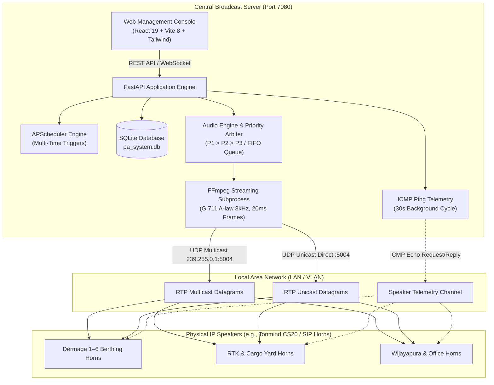

<p align="center">
  
</p>

# IntanWave — Industrial IP Speaker & Maritime Public Address (PA) System

[](#)
[](#)
[](#linux-server-deployment-docker-compose)
[](https://fastapi.tiangolo.com)
[](https://vitejs.dev)
[](#physical-ip-speaker-configuration)
[](#)
[](#docker-resource-limits)
[](LICENSE)

**IntanWave** is a centralized, industrial IP Public Address (PA) and automated audio broadcast server engineered for maritime ports, cargo terminals, warehouses, and industrial facilities. It delivers synchronized, low-latency audio streams directly to physical IP horn speakers (e.g. Tonmind CS20 and SIP/RTP-compatible horns) using **RTP Multicast (`239.255.0.1:5004`)** and targeted **Unicast RTP** channels.

[Quickstart](#linux-server-deployment-docker-compose) • [System Architecture](#system-architecture) • [Core Capabilities](#core-engineering-capabilities) • [Speaker Setup](#physical-ip-speaker-configuration) • [Environment Variables](#environment-variables)

---

## Overview

IntanWave replaces fragmented broadcast setups—such as desktop alarm utilities and uncoordinated media players spread across client workstations—with a unified, local-first broadcast server. Transcoding is performed on-the-fly via FFmpeg directly to telecom-grade RTP streams, egressing over physical network switches to hardware IP horn speakers deployed throughout docks, container yards, and operations offices.

The application operates entirely on local network infrastructure (LAN/VLAN) without external cloud dependencies or telemetry. System configuration, automated schedules, speaker inventories, and operational audit records persist in a local, transactional SQLite database.

---

## Practical Use Cases

- **Maritime Cargo Terminals & Berths**: Broadcast scheduled occupational health and safety (K3) announcements, muster calls, and docking alerts across open-air dock speakers without clock drift.
- **Container Yards & Logistics Warehouses**: Route zone-specific audio (e.g., RTK Yard vs. Maintenance Bays) to designated speakers simultaneously without interrupting adjacent operations.
- **Facility Emergency Response & Evacuation**: Trigger instant, high-priority emergency sirens that immediately preempt all active schedules and routine broadcasts across all terminal zones.
- **Shift & Operational Routines**: Automate daily operational shift announcements (morning roll calls, rest breaks, shift handovers) through multi-time schedule rules from a centralized web dashboard.

---

## Core Engineering Capabilities

- **Telecom-Standard Audio Encoding (8 kHz G.711 A-Law)**: Audio files are transcoded on-the-fly to single-channel 8 kHz PCMA at 64 kbps, matching the native DSP decoding specification of industrial VoIP/SIP horn speakers.
- **Strict 20ms Frame Pacing**: FFmpeg filter chains apply strict resampling and sample chunking (`aresample=8000:async=1,asetnsamples=n=160`) to eliminate sample accumulation, clock drift, and buffer underruns during sustained multi-minute broadcasts.
- **Locked 172-Byte Datagrams**: Packet sizing is constrained to 172 bytes (`?pkt_size=172` = 160 bytes audio payload + 12 bytes RTP header), matching the input jitter buffers of IP speaker hardware.
- **Coordinated SSRC Tee Muxing**: Multi-destination transmissions use FFmpeg tee muxing with synchronized SSRC identifiers (`[select=a:f=rtp:ssrc={id}:seq=0]`) to ensure multicast and unicast endpoints play in phase alignment without acoustic echo.
- **Multi-Zone Parallelism & Priority Preemption**: Non-overlapping speaker zones broadcast concurrently. When zone contention occurs, a three-tier priority arbiter takes effect:
  - **Priority 1 (Emergency / Darurat)**: Immediately preempts any active broadcast across targeted endpoints.
  - **Priority 2 (Safety / K3)**: Takes precedence over routine schedules.
  - **Priority 3 (Routine / Schedule)**: Automatically yields; conflicting automated schedules are deferred to a FIFO queue until speakers are free.
- **Multi-Time Group Broadcast Scheduler**: Single scheduled rules support multiple execution timestamps per day (e.g., `07:30`, `11:45`, `14:00`, `16:56`) with shift presets and a real-time countdown card for the nearest upcoming broadcast.
- **Asynchronous ICMP Ping Telemetry**: Non-blocking background workers ping all registered IP speakers every 30 seconds, streaming real-time latency and online/offline status to connected clients over WebSockets.
- **Broadcast Confirmation Guard**: Manual broadcasts from the Audio Library require explicit confirmation dialogs to prevent inadvertent live port transmissions.

---

## System Architecture



---

## Repository Structure

```text
audio-server-ip-speaker/
├── backend/
│   ├── app/
│   │   ├── audio_engine.py       # RTP stream orchestrator, tee muxing, and priority preemption
│   │   ├── config.py             # Environment configuration, registry PATH recovery, storage paths
│   │   ├── database.py           # SQLite migrations, schema definitions, and audit event logs
│   │   ├── main.py               # FastAPI endpoints, WebSocket manager, and static file serving
│   │   ├── ping_service.py       # Asynchronous parallel ICMP ping telemetry engine
│   │   └── scheduler.py          # APScheduler cron/interval runner with multi-time trigger parsing
│   ├── storage/
│   │   ├── audio/                # Local repository for WAV/MP3 broadcast files
│   │   └── pa_system.db          # Persistent SQLite database (WAL mode)
│   └── requirements.txt          # Python backend dependencies
├── frontend/
│   ├── public/
│   │   ├── favicon.ico           # Application favicon
│   │   └── logo.png              # IntanWave branding logo
│   ├── src/
│   │   ├── App.jsx               # Dashboard, broadcast triggers, scheduler, and speaker tables
│   │   ├── index.css             # Industrial styling and theme specifications
│   │   └── main.jsx              # React DOM entrypoint
│   ├── package.json              # Node.js dependencies (React 19, Tailwind CSS v4, Vite 8)
│   └── vite.config.js            # Vite bundler configuration
├── deploy-linux.sh               # Automated one-step deployment script for Linux servers
├── docker-compose.yml            # Production container configuration with host networking
├── Dockerfile                    # Multi-stage production container build (Node 20 + Python 3.12)
├── run_server.py                 # Bare-metal local server launcher (port 7080)
├── LICENSE                       # MIT License
└── README.md                     # System documentation
```

---

## Deployment & Operations

### Linux Server Deployment (Docker Compose)

Host networking mode (`network_mode: "host"`) is required so UDP Multicast datagrams (`239.255.0.1:5004`) egress directly to the physical network interface without Docker bridge NAT translation.

```bash
# 1. Clone repository
git clone https://github.com/pratama1246/IntanWave-RTPAudio.git
cd IntanWave-RTPAudio

# 2. Grant execution permission and run deployment script
chmod +x deploy-linux.sh
./deploy-linux.sh
```

Alternatively, run directly via Docker Compose:

```bash
docker compose up -d --build
```

- **Web Dashboard**: `http://<SERVER_IP>:7080`
- **Health Check Endpoint**: `http://<SERVER_IP>:7080/api/health`
- **Container Logs**: `docker compose logs -f`

#### Docker Resource Limits

Resource caps are enforced in `docker-compose.yml` to prevent noisy-neighbor memory exhaustion:

```yaml
mem_limit: 150m
mem_reservation: 64m
deploy:
  resources:
    limits:
      memory: 150M
    reservations:
      memory: 64M
```

---

### Bare-Metal Setup (Local Development)

Prerequisites:
- **Python 3.10+**
- **Node.js 20+**
- **FFmpeg & FFplay** installed and accessible in the system `PATH`

```bash
# 1. Build frontend bundle
cd frontend
npm install
npm run build
cd ..

# 2. Install backend dependencies
pip install -r backend/requirements.txt

# 3. Launch server
python run_server.py
```

The web dashboard is served at `http://localhost:7080`.

For active UI development with Vite hot module reloading:

```bash
# Terminal 1: Backend
python run_server.py

# Terminal 2: Frontend Dev Server
cd frontend
npm run dev
```

---

## Physical IP Speaker Configuration

To ensure stable playback on physical IP horn speakers (e.g., Tonmind CS20):

1. Open the IP Speaker web administration console.
2. Under **Audio Settings / RTP Multicast**, configure:
   - **Multicast IP**: `239.255.0.1`
   - **Port**: `5004`
   - **Audio Codec**: `PCMA (G.711 A-Law)`
   - **Sample Rate**: `8000 Hz`
   - **Priority**: Set priority level per site policy (`Priority 1` or `Priority 3`).
3. Under **Advanced / Hardware Settings**:
   - **Amp Auto OFF**: Set to `NO`. Disabling this prevents the speaker's internal power amplifier relay from cycling during short conversational pauses.
   - **Jitter Buffer**: Set to `360 ms` or `500 ms` to absorb transit delays during sustained announcements over local network switches.
4. Save and apply settings.

---

## Environment Variables

| Variable | Default | Description |
|---|---|---|
| `PORT` | `7080` | Port for Web Management Console and REST/WebSocket API |
| `MULTICAST_IP` | `239.255.0.1` | Target IPv4 Multicast group address |
| `MULTICAST_PORT` | `5004` | Target UDP audio port for multicast and unicast RTP |
| `TZ` | `Asia/Jakarta` | Local system timezone for APScheduler cron schedules |
| `FRONTEND_DIST` | `../frontend/dist` | File path to precompiled frontend static assets |

---

## License

This project is licensed under the [MIT License](LICENSE).
